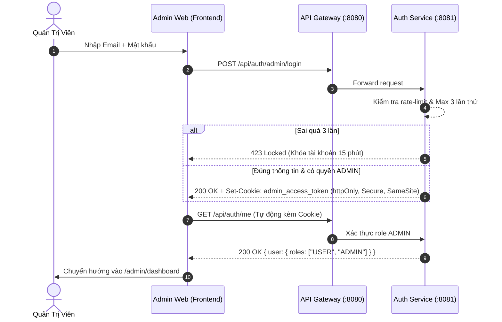

# Admin Authentication, Security Flow & Route Guards

## 1. Context & Self-Contained Scope
Tài liệu này đặc tả toàn bộ quy trình xác thực, route guards và cơ chế an ninh mạng của **Snapgram Admin Portal**. Tài liệu hoạt động độc lập (self-contained) và gắn kết với:
- [overview.md](../overview.md): Kiến trúc phân hệ và định vị hệ thống.
- [conventions.md](conventions.md): Quy chuẩn viết code, xử lý cookie và token.
- [api-integration-map.md](api-integration-map.md): Danh mục API xác thực admin và phản hồi lỗi.
- [absolute-rules.md](../absolute-rules.md): Các điều luật bảo mật và UI bất biến.

---

## 2. Trang Login Chặn Trước Khi Vào Trang Admin (`/admin/login`)

Tất cả truy cập vào bất kỳ phân hệ nào thuộc `/admin/*` đều bị chặn hoàn toàn bởi **Next.js 15 Middleware** ở cấp độ Server-side Edge Runtime trước khi component được render.

### 2.1. Yêu Cầu Chức Năng Trang Login (`/admin/login`)
1. **Kiến Trúc Tách Biệt:** Giao diện đăng nhập Admin chạy độc lập, không hiển thị Sidebar hay Topbar của Dashboard.
2. **Form Đăng Nhập:**
   - Trường Email hoặc Username (validation bắt buộc).
   - Trường Mật khẩu (ẩn/hiển thị mật khẩu qua icon con mắt, Lucide `Eye`/`EyeOff`, không dùng emoji).
   - Nút Submit với hiệu ứng loading (disable khi đang gửi request).
3. **Cơ Chế Bảo Vệ & Phản Hồi:**
   - **Chống Brute-force:** Giới hạn tối đa 3 lần thử sai liên tiếp. Backend Auth Service phản hồi `423 Locked`, frontend hiển thị đếm ngược 15 phút và khóa form.
   - **Xác Thực Vai Trò:** Sau khi kiểm tra mật khẩu thành công, hệ thống kiểm tra claim `roles`. Nếu người dùng không sở hữu role `ROLE_ADMIN` hoặc `ROLE_MODERATOR`, trả về lỗi `403 Forbidden` và không cấp quyền truy cập.
   - **Cấp Cookie:** Server trả về Set-Cookie `admin_access_token` có cờ `httpOnly; Secure; SameSite=Strict`.

---

## 3. Cơ Chế Xác Thực Kép & Cookie httpOnly

Admin Portal sử dụng cơ chế bảo mật cao cấp hơn app người dùng thông thường:



---

## 4. Quy Tắc Route Guards & Quyền Hạn (RBAC Guard)

### 4.1. Middleware / Route Guard Logic (Next.js 15 Middleware)
```typescript
// Next.js 15 Middleware bảo vệ toàn bộ route /admin/*
import { NextResponse } from 'next/server';
import type { NextRequest } from 'next/server';

export async function middleware(request: NextRequest) {
  const { pathname } = request.nextUrl;
  const adminToken = request.cookies.get('admin_access_token')?.value;
  
  // 1. Nếu chưa có cookie xác thực và truy cập vào trang dashboard
  if (!adminToken && pathname.startsWith('/admin') && pathname !== '/admin/login') {
    const loginUrl = new URL('/admin/login', request.url);
    loginUrl.searchParams.set('redirect', pathname);
    return NextResponse.redirect(loginUrl);
  }

  // 2. Nếu đã đăng nhập mà vẫn cố vào trang login
  if (adminToken && pathname === '/admin/login') {
    return NextResponse.redirect(new URL('/admin/dashboard', request.url));
  }

  return NextResponse.next();
}

export const config = {
  matcher: ['/admin/:path*'],
};
```

### 4.2. Phân Tầng Quyền Hạn Trong Trang Admin
- **`SUPER_ADMIN` / `ADMIN`:** Toàn quyền truy cập mọi tab (User ban/unban, RBAC roles, System Health).
- **`MODERATOR`:** Chỉ có quyền truy cập tab `/admin/moderation/reports`, không thể vào tab `/admin/users` hoặc phân quyền RBAC. UI tự động ẩn các menu tương ứng trên Sidebar.

---

## 5. Chính Sách Chống Tấn Công Phổ Biến

1. **CSRF Protection:** Các mutation request (`POST`, `PATCH`, `DELETE`) đi kèm Header `X-Requested-With: XMLHttpRequest` hoặc CSRF token theo chuẩn Spring Security.
2. **Session Revocation khi Ban User:**
   - Khi Admin bấm Ban tài khoản qua `POST /api/auth/admin/users/{userId}/ban`, backend lập tức thu hồi toàn bộ Refresh Token của user đó trong Redis/Database.
   - User bị ban sẽ bị văng khỏi hệ thống ngay trong lần request kế tiếp.
3. **CORS:** Cấu hình nguồn gốc chính xác (Origin) của trang Admin trong `SecurityConfig.java`, cấm hoàn toàn `allowCredentials: true` với wildcard `*`.

---

## 6. Refresh Token — TBD (Chưa xử lý)

Backend hiện trả `refreshToken` nhưng Frontend CHƯA implement refresh flow.
Các câu hỏi mở:
- TBD1: refreshToken nằm ở cookie httpOnly hay trong response body?
- TBD2: refresh flow dùng endpoint `/api/auth/refresh` như thế nào?
- TBD3: auto-refresh trước khi access token hết hạn ra sao?
- TBD4: silent refresh (BE tự set cookie mới) hay FE phải trigger?

Hành vi tạm thời ở sprint hiện tại:
- Access token hết hạn → API trả 401 → FE redirect về `/admin/login`.
- KHÔNG implement auto-refresh.
- Khi BE chốt cơ chế refresh → cập nhật mục này.
