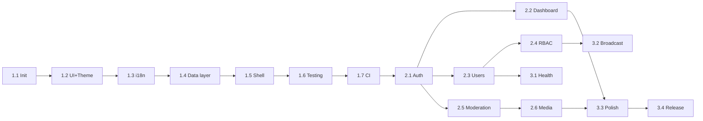

# Detailed Sprint Plan (Phase 1 → Phase 3, 17 Sprints) — Snapgram Admin Portal

## 1. Context & Self-Contained Scope

Tài liệu này xác lập lộ trình triển khai độc lập (self-contained) của **Snapgram Admin Portal** theo 17 sprint, chia thành 3 phase. Tài liệu gắn kết trực tiếp với:

- [bootstrap-commands.md](bootstrap-commands.md): Lệnh CLI chính quy cho Phase 1 (Sprint 1.1 → 1.7).
- [definition-of-done.md](definition-of-done.md): Tiêu chuẩn nghiệm thu Definition of Done.
- [../overview.md](../overview.md): Kiến trúc tổng quan và phạm vi phân hệ.
- [../architect/route-map.md](../architect/route-map.md): Bản đồ route và màn hình.

> **NGUYÊN TẮC:** Mỗi sprint là một đơn vị bàn giao độc lập, chỉ được coi là "Done" khi thỏa mãn toàn bộ Exit criteria và Definition of Done.

---

## 2. Tổng Quan 3 Phase

| Phase | Phạm vi | Sprints | Mục tiêu chính |
| ----- | ---------------------------------- | ----------- | ------------------------------------------------------------- |
| **Phase 1 — Foundation** | Hạ tầng & khung nền | 1.1 → 1.7 | Dựng bộ khung Next.js 15, UI kit, i18n, data layer, testing, CI. |
| **Phase 2 — Core Features** | Nghiệp vụ cốt lõi | 2.1 → 2.6 | Auth, Dashboard, User Mgmt, RBAC, Moderation, Media. |
| **Phase 3 — Advanced & Ops** | Nâng cao & vận hành | 3.1 → 3.4 | Health, Broadcast, Polish (a11y/i18n), Hardening & Release. |

---

## 3. Bảng Sprint Chi Tiết (17 Sprints)

| Sprint | Mục tiêu | Deliverables | Exit criteria |
| ------ | ------------------------------------------------------- | -------------------------------------------------------------------------------------------------------------------------------------------------------------------------------------- | ---------------------------------------------------------------------------------------------------------------------------- |
| **1.1** | Khởi tạo repository & framework | Repo `admin-client` (Next.js 15 App Router, TS strict, Tailwind, ESLint, pnpm 10, Node 22), `package.json` ghim `packageManager`/`engines`. | `pnpm dev` chạy; `tsconfig.json` có `"strict": true`; `pnpm-lock.yaml` tồn tại; `src/app/layout.tsx` + `page.tsx` render OK. |
| **1.2** | Tailwind + shadcn/ui + Theme & Icons | `globals.css` có CSS variables; `components.json`; 17 component shadcn kéo qua CLI; cài `next-themes` + `lucide-react`. | Đủ `src/components/ui/*.tsx`; `ThemeProvider` bọc root; toggle Light/Dark/System hoạt động; không FOUC. |
| **1.3** | Đa ngôn ngữ (i18n) | Cài `next-intl`; cấu trúc route `/[locale]/admin/...`; `messages/vi.json` + `messages/en.json`. | Chuyển locale render đúng; không hardcode chuỗi; fallback locale hoạt động. |
| **1.4** | TanStack Query & HTTP client | Cài `@tanstack/react-query`, `axios`, `zod`; `QueryClientProvider`; API client wrapper `withCredentials: true`; error interceptor (401/403/429). | Gọi thử 1 endpoint qua Gateway `:8080` thành công; interceptor xử lý 401 → redirect login. |
| **1.5** | Zustand & Layout Shell | Cài `zustand`; `MasterShell` + `SidebarNavigation` (collapse 260px↔72px) + Topbar + Breadcrumbs. | Layout responsive desktop/mobile; state `isSidebarCollapsed`, `isCommandOpen` hoạt động; các route placeholder render trong shell. |
| **1.6** | Testing framework | Cài `vitest`, RTL, `msw`, `@playwright/test`, `@axe-core/playwright`; cấu hình `vitest.config.ts`, `playwright.config.ts`. | `pnpm test` chạy 1 test mẫu pass; `pnpm exec playwright test` chạy 1 smoke E2E pass. |
| **1.7** | Git hooks & CI quality gate | `husky` + `lint-staged` + `commitlint`; hook `pre-commit`/`commit-msg`; pipeline CI (lint, typecheck, test, build). | Commit sai Conventional Commits bị chặn; CI pipeline chạy xanh trên PR mẫu. |
| **2.1** | Auth: Admin Login + Guards + 2FA | `AdminLoginForm`, route guard middleware, `TwoFactorVerifyModal` (OTP 6 số), xử lý 401/423 lockout countdown. | Login qua `POST /api/auth/admin/login` set cookie httpOnly; guard chặn route khi chưa login; 423 hiển thị đếm ngược. |
| **2.2** | Dashboard & Metrics | `StatMetricCard`, `ActivityFeedCard`, `ModerationQuickBar`; kết nối `GET /api/auth/admin/dashboard/stats`. | Stats render đúng; skeleton loading; refetch hoạt động; empty/error state đầy đủ. |
| **2.3** | User Management | `UserDataTable` (phân trang, tìm kiếm debounce 300ms), `UserTableFilters`, `UserStatusBadge`, `UserActionMenu`, `BanUserDialog`, `UnbanConfirmDialog`, `RoleAssignMenu`, `UserDetailDialog`; ban/unban + gán/gỡ role. | CRUD trạng thái user hoạt động; invalidate query key đúng; xác nhận 2 bước cho hành động phá hủy. |
| **2.4** | RBAC & Permissions | Trang quản lý vai trò: `RoleDataTable`, `RoleDetailDialog`, `PermissionMatrix` (compound, group theo category), `CreateRoleDialog`, `EditRoleDialog`, `DeleteRoleDialog`; kết nối `GET/POST/PUT/DELETE /api/auth/admin/roles` + `GET /api/auth/admin/permissions` + `PUT /roles/{id}/permissions`. | Tạo/sửa/xoá role (custom); system role bị chặn sửa/xoá; ma trận permission lưu đúng; invalidate query key đúng. *(Gán/gỡ role cho user đã làm ở Sprint 2.3; "role-filtered sidebar" hoãn sang Sprint 3.3.)* |
| **2.5** | Content Moderation | `ReportQueueTable` (tabs Pending/Reviewed/Resolved/Dismissed), `ReportDetailSheet`, resolve/dismiss report. | Queue lọc theo tab; mở chi tiết report; resolve/dismiss cập nhật tức thì; xử lý target đã xóa. |
| **2.6** | Media Management | `MediaUploader` (presigned 3 bước + progress), `MediaDirectUploader`, `MediaLibraryGrid`, `MediaDeleteConfirm`; xử lý URL hết hạn. | Upload presigned/direct thành công; progress + cancel/retry; gallery phân trang; xóa media cập nhật grid. |
| **3.1** | System & Health | Trang `Health Check` (`GET` health endpoints), `ServiceStatusPill` (Gateway Online), link ngoài Kafka UI (:8089) & MinIO (:9001). | Hiển thị trạng thái từng service; pill cập nhật theo polling; link ngoài mở tab mới. |
| **3.2** | Notification & Broadcast | Form tạo thông báo toàn hệ thống (`PrimaryActionButton` gradient), lịch sử broadcast, toast `sonner`. | Tạo broadcast thành công; toast success/error đúng duration; dedup toast lỗi lặp. |
| **3.3** | Polish: A11y, i18n audit, Error/Empty/Loading states | Audit a11y (axe), focus ring, keyboard nav, ARIA; rà soát i18n 100% key; chuẩn hóa skeleton/empty/error toàn hệ thống. | `@axe-core/playwright` 0 violation nghiêm trọng; 0 chuỗi hardcode; mọi màn hình có đủ 4 trạng thái UI. |
| **3.4** | Hardening & Release | E2E full flow, kiểm tra performance (bundle, LCP), security review (cookie/token), tài liệu bàn giao, tag release. | E2E suite xanh; cảnh báo performance trong ngưỡng; security review pass; tag `v1.0.0` + changelog. |

---

## 4. Sprint Dependencies (Ràng buộc phụ thuộc)

---

## 5. Ghi Chú & TBD

- **Thứ tự cứng:** Phase 1 bắt buộc tuần tự 1.1 → 1.7 (nền tảng). Phase 2 có thể song song một phần (Dashboard song song User Mgmt) nếu đủ nguồn lực.
- **Uỷ quyền lệnh:** Mọi lệnh cài đặt/cấu hình của Phase 1 tuân thủ [bootstrap-commands.md](bootstrap-commands.md) — CẤM viết tay config.
- **TBD:** Thời lượng từng sprint (story points/ngày) chưa chốt → xác nhận với team khi bắt đầu.
- **TBD:** Số lượng sprint Phase 2/3 có thể điều chỉnh nếu backend bổ sung endpoint mới (xem [../backend-issues/README.md](../backend-issues/README.md)).

---

## 6. Skills Áp Dụng Theo Sprint (Phase 2 → 3)

| Sprint | Skills áp dụng |
|---|---|
| 2.3 (users) | tanstack-query, frontend-design |
| 2.4 (rbac) | tanstack-query, frontend-design, vercel-composition-patterns |
| 2.5 (moderation) | tanstack-query, frontend-design, vercel-composition-patterns |
| 2.6 (media) | tanstack-query, frontend-design |
| 3.3 (polish) | web-design-guidelines |

Local path từng skill: xem [../architect/skills.md](../architect/skills.md) §5.
Khi dispatch subagent cho các sprint trên, thêm dòng `ĐỌC SKILL: <local path>` vào prompt.

---

> ⚠️ Tài liệu tạm nằm trong backend repo. Sẽ move sang FE repo khi tách.
